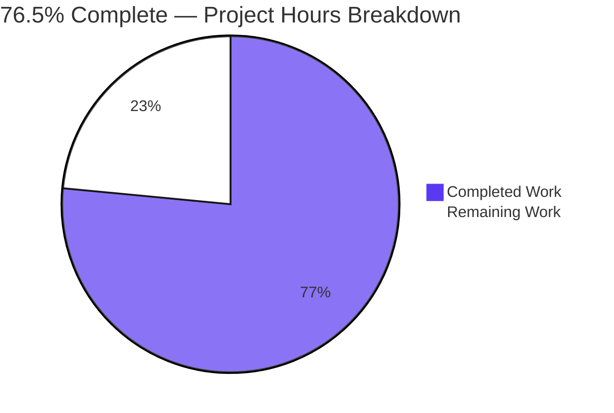
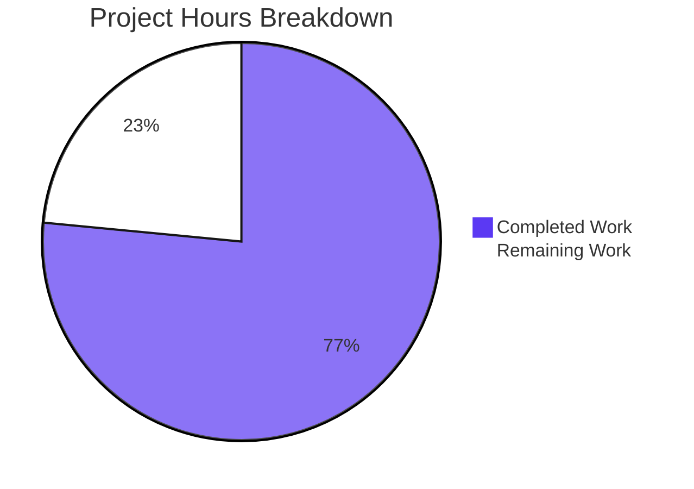

# 1. Executive Summary

## 1.1 Project Overview

nodejs-tutorial-hello-world is a teaching artefact: a single-file, zero-dependency Node.js HTTP server that answers `GET /hello` with `Hello world` and every other method or path with `404 Not Found`, with an npm manifest and a README that carries a reader from prerequisites to configuration. Its audience is developers learning Node's built-in `http` module and anyone needing a dependency-free liveness target. Impact is educational, not transactional: no data, credential, session or outbound connection exists. Scope is three flat files — `server.js`, `package.json`, `README.md` — console observability, one input (`PORT`) and a graceful stop on `CTRL+C`.

## 1.2 Completion Status



**76.5% complete** — 50.5 hours delivered of 66 total hours.

| Metric | Value |
|---|---|
| Total Hours | 66 |
| Completed Hours (AI + Manual) | 50.5 |
| Remaining Hours | 15.5 |
| Completion | 76.5% |

All 53 scoped requirements are delivered and verified; the remaining hours are deployment-readiness work outside the build scope, plus one verification gap. Calculation: 50.5 ÷ 66 = 76.5%.

## 1.3 Key Accomplishments

- **Response contract** — `GET /hello` returns 200, `text/plain`, byte-exact `Hello world`; everything else returns 404 (`server.js:32-61`).
- **Match semantics** — routing uses the parsed pathname, so query strings are ignored and `/hello/`, `//hello`, `/HELLO` stay unmatched (`server.js:44-54`).
- **Configuration** — `PORT` is the only input; 1024–65535 is enforced and privileged ports are refused with exit 1 (`server.js:7-24`).
- **Failure reporting** — bind failures print an actionable stderr line, exit 1, never a stack trace (`server.js:64-77`).
- **Lifecycle** — ordered shutdown pair, idle connections released, in-flight responses finished, exit 0 on `CTRL+C` (`server.js:80-117`).
- **Observability** — one conforming `[ISO-8601 UTC] METHOD path` line per request, before routing.
- **Measured behaviour** — p95 0.23–0.25 ms against 10 ms; 200/200 concurrent answered; +0.412 MiB GC-normalised over 10,000 requests.
- **Zero-install package** — `node server.js` and `npm start` run it with no lockfile or `node_modules`.

## 1.4 Critical Unresolved Issues

All 53 scoped requirements are delivered and verified (53 of 53). Six items remain open, all path-to-production work.

| Issue | Impact | Owner | ETA |
|---|---|---|---|
| No production packaging or supervision is defined (service unit or image, fixed port, restart policy, non-root user) | The server must be started by hand; no restart on failure | Platform engineer | 1–2 days |
| Hosting platforms that stop processes with `SIGTERM` bypass graceful shutdown | In-flight responses are lost and neither shutdown line is written | Release engineer | 1 day |
| A departed log consumer terminates the process (unhandled `EPIPE`) | Any log pipeline that closes the pipe takes the server down | SRE | 1 day |
| The declared `>=18.0.0` engine floor was never exercised on an 18.x binary | Advertised v18 support is asserted rather than demonstrated | Maintainer | 0.5–1 day |
| The listener binds every interface with no host input | `GET /hello` is reachable from the whole network segment | Network owner | 0.5 day |
| Five comment- and wording-level departures from the plan of record need alignment | Spec and code read differently to a future maintainer | Maintainer | 0.5 day |

## 1.5 Access Issues

No access issues identified. The repository, runtime and loopback interface were reachable, and no credential or third-party service is involved.

## 1.6 Recommended Next Steps

1. **[High]** Package and supervise the deliverable — service unit or image, fixed port, restart policy, non-root user.
2. **[High]** Settle the stop path for platforms that signal `SIGTERM`, then verify a graceful stop under load.
3. **[Medium]** Wire stdout into the platform log pipeline and decide the departed-consumer policy.
4. **[Medium]** Raise `engines.node` to a supported LTS line, or verify the declared floor on 18.x.
5. **[Low]** Reconcile the five plan-wording departures in `server.js` and re-run the gates.

# 2. Project Hours Breakdown

## 2.1 Completed Work Detail

| Component | Hours | Description |
|---|---|---|
| HTTP request handling, routing and the response contract (`server.js:32-61`) | 9 | `sendText` as the single response writer, the pathname parsed in `try`/`catch`, the single exact match, both literal bodies, the fixed placeholder for unparsable targets |
| Port resolution and the configuration contract (`server.js:7-24`) | 5 | Default applied only to an absent `PORT`, integer 1024–65535 validation, the byte-exact rejection message, exit status 1 on every violation |
| Bind-failure reporting and exit statuses (`server.js:64-77`) | 3 | `error.code` discrimination, the `EADDRINUSE` literal, the generic `<port>: <code> <message>` form, no stack trace on any path |
| Graceful `SIGINT` shutdown lifecycle (`server.js:80-99`) | 4 | Ordered shutdown pair, idle-connection release behind a `typeof` guard, in-flight responses finished, exit 0 preserved against a recorded fatal status |
| Startup banner and listener wiring (`server.js:102-118`) | 2 | Non-number guard, server `error` listener, one `SIGINT` registration, startup line from the listen callback |
| Zero-dependency manifest and run path (`package.json:1-19`) | 1.5 | Seven fixed fields in order, `main` and `scripts.start`, `engines.node`, no dependency key and no `type` |
| README documentation (`README.md`) | 5 | Eight sections, real observed output for every example, the `PORT` table, the parser-rejection note |
| Performance and resource verification | 6 | The fixed latency method and its figures, 200-way concurrency, GC-normalised memory across 10,000 requests |
| Security posture verification | 5 | Injection, traversal and log-forging sweeps, response-disclosure checks, filesystem, socket and persistence boundaries |
| Whole-package gate harness and boundary verification | 7 | The full command set run as one suite, the rejection table, the accepted-boundary probes, the run-path check |
| Console contract and log-safety behaviour (`server.js:26-29`, `server.js:52`) | 3 | Fixed line format, write-before-route, query-free path field, client-supplied text kept out of the log |
| **Total** | **50.5** | |

## 2.2 Remaining Work Detail

| Category | Hours | Priority |
|---|---|---|
| Deployment packaging and supervision for the target host — service unit or image, fixed port allocation, restart policy, non-root service user *(path to production)* | 4 | High |
| Operator stop contract for hosting platforms that signal `SIGTERM`, which the delivery does not handle *(path to production)* | 3 | High |
| Log-stream integration for stdout, including the failure policy for a consumer that goes away *(path to production)* | 3 | Medium |
| Engine-floor verification on an 18.x binary for the declared `>=18.0.0` range, or a raised floor *(verification gap)* | 2 | Medium |
| Network-exposure decision for the all-interface bind *(path to production)* | 1.5 | Medium |
| Specification-alignment pass over the five wording departures in `server.js` *(plan alignment)* | 2 | Low |
| **Total** | **15.5** | |

**Arithmetic:** completed 50.5 + remaining 15.5 = 66 total hours, and 50.5 ÷ 66 = **76.5% complete**. No scoped requirement is counted as outstanding: every hour above traces to the deployment, operation or verification of a delivered requirement rather than to work on one that was never finished.

# 3. Test Results

The product ships no test suite by design — a test framework, a test directory and a committed test file are all excluded by the zero-dependency mandate, which makes the project's own command set the suite. Every row below is a group of checks executed against the running server on Node v22.23.3; **169 checks were executed, 169 passed, 0 failed.** No coverage figure is reported because no coverage tool exists in this product.

| Area / Category | Framework | Tests | Passed | Failed | Coverage | What This Proves |
|---|---|---|---|---|---|---|
| Repository and static integrity | shell, `node --check`, grep census | 17 | 17 | 0 | Not measured — no coverage tool ships | The package is three flat files with a syntax-clean, single-import, dependency-free source and no dynamic-evaluation, filesystem or outbound surface |
| Request handling and the response contract | curl and a raw TCP client | 25 | 25 | 0 | Not measured | Both endpoints, the match semantics and the hostile-target path behave as specified, down to byte counts, headers and framing |
| Configuration and the `PORT` contract | shell and curl | 44 | 44 | 0 | Not measured | The default, the override, the nine-value rejection table and both accepted boundaries behave exactly as documented |
| Bind-failure reporting and exit statuses | shell | 11 | 11 | 0 | Not measured | Every fatal bind path exits 1 with the exact message, an empty stdout and no stack trace, leaving an incumbent untouched |
| Startup, logging, shutdown and lifecycle | shell, signals, curl | 32 | 32 | 0 | Not measured | One startup line, one conforming log line per request, idle connections released, in-flight answers finished and exit 0 on stop |
| Performance and resource behaviour | Node harnesses (`http`, `perf_hooks`, `--expose-gc`) | 14 | 14 | 0 | Not measured | Latency, concurrency and memory stay inside their targets with wide margins at every load shape tried |
| Documentation, manifest and run path | shell, curl, npm | 26 | 26 | 0 | Not measured | Every documented literal reproduces in a real run and both entry points boot the same server with no install |
| **Total** | — | **169** | **169** | **0** | — | — |

### Not Covered

- **The declared `>=18.0.0` engine floor.** No 18.x binary was exercised; the only API absent at that floor (`server.closeIdleConnections`, added in v18.2.0) is called behind a `typeof` guard whose false branch no available runtime reaches. A human should either verify the floor on a v18 binary or raise `engines.node` to a line the deployment actually uses.
- **The generic non-`EADDRINUSE` bind failure as nature produces it.** No valid bind fails that way on this host, so the branch is reached only through synthetic error injection and file-descriptor starvation.
- **A codeless bind error.** Unreachable in practice because every bind failure carries a `code`; if one occurred it would render the code slot literally as `undefined`.
- **Browser, visual, responsive and accessibility surfaces.** None exists — no page, component, stylesheet or script — so nothing of that kind was or could be exercised. Anyone extending the product beyond a plain-text endpoint should add that coverage.
- **Multi-host, proxy and load-balancer behaviour.** No second host, proxy or balancer was in play, so drain-at-the-edge behaviour during a restart is unverified.
- **Coverage measurement.** No coverage tool is available in this product, so the pass counts above are check counts, not line or branch coverage.
- **What a human should still test before release:** the deployment's own start and stop path under the platform's signal (typically `SIGTERM`), a stop while production traffic is in flight, and how the log pipeline behaves when its consumer disappears.

# 4. Runtime Validation & UI Verification

Every line below was driven against the running server on a loopback port, with the process stopped afterwards and the port confirmed released.

- ✅ **Start-up** — `node server.js` prints `Server listening on port 3000` on stdout with an empty stderr and accepts connections, both on the documented default and on a configured override.
- ✅ **Primary journey, `GET /hello`** — 200 with `Content-Type: text/plain` and a byte-exact 11-byte `Hello world`, confirmed over both curl and a raw TCP socket.
- ✅ **Catch-all routing** — `404 Not Found` across 13 method and path forms, including `HEAD` (headers only, zero body bytes), `OPTIONS`, `POST`, and the hostile `/\` and `http://[::1` targets, none of which resets the connection.
- ✅ **Configuration** — the default resolves from an absent `PORT`, `PORT=4000` serves on 4000, nine rejected values each exit 1 with empty stdout and the byte-exact message, and the accepted boundaries 1024 and 65535 start, serve and stop cleanly.
- ✅ **Bind failure** — a second bind on a held port exits 1 with the exact `EADDRINUSE` line and no stack trace while the incumbent keeps serving and then stops cleanly; the generic form renders `<port>: <code> <message>`.
- ✅ **Graceful stop** — `SIGINT` prints the ordered shutdown pair exactly once, exits 0 and releases the port; a request already in flight is answered before the pair.
- ⚠️ **Partial — stop under load** — a burst still firing when the signal arrives has requests refused rather than answered (49 of 200 answered and logged, 151 refused), and a connection that never completes a request holds the process open until the peer leaves (still running 4 s after the signal, completing on disconnect).
- ⚠️ **Partial — log-consumer failure** — when stdout's reader disappears (for example a pipe into a command that exits), the next log write raises an unhandled `EPIPE` and the process terminates, leaving no listener behind.
- ✅ **Concurrency and resources** — 200/200 simultaneous requests answered correctly with no body mismatch or socket error; p95 0.23–0.25 ms over 500-sample runs; +0.412 MiB GC-normalised heap across 10,000 requests with 0 bad responses.
- ✅ **Run path** — `node server.js` and `npm start` both boot the same server and serve `Hello world` with no install step, creating no `package-lock.json` and no `node_modules`.

**External integrations:** none exist. The product makes no outbound request, opens no database, cache or queue, and reads no credential; its socket table holds only its own listener plus accepted inbound connections, so there is no third-party integration to drive.

**Never exercised at runtime:** any browser, visual or accessibility surface (none exists in this product — there is no page, component, stylesheet or script to render); the declared Node `>=18.0.0` floor (only v22.23.3 was available); a naturally occurring generic bind failure; and any behaviour behind a proxy, load balancer, container health check or a second host.

# 5. Compliance & Quality Review

## 5.1 Compliance Matrix

| Deliverable / Requirement | Benchmark | Status | Verified State |
|---|---|---|---|
| Single-file implementation, only `http` imported | Architecture and dependency hygiene | ✅ Pass | `server.js` is the whole implementation (120 lines, 7 functions, no exports); one `require` in the file and three tracked paths in the repository |
| Manifest with the seven fixed fields and no dependency key | Build reproducibility | ✅ Pass | Key census matches the fixed list in order; dependency-surface count 0; no `type` field; no lockfile produced by any run |
| README sections with output a real run produces | Documentation accuracy | ✅ Pass | Every documented literal reproduces command by command, including both bodies, the two shutdown lines and the header block apart from the dynamic `Date` |
| Repository hygiene: three flat files, nothing else | Repository hygiene | ✅ Pass | `git ls-files` returns `README.md`, `package.json`, `server.js`; no `node_modules`, no CI, container or configuration file |
| No placeholder, TODO, stub or dead code | Completeness | ✅ Pass | Marker sweep clean; the single `placeholder` hit is the log rationale comment; `node --check server.js` exits 0 |
| Functional contract for both endpoints and the failure paths | Functional correctness | ✅ Pass | Both endpoints, 13 method/path forms, the full `PORT` matrix and every bind-failure path exercised at runtime |
| Configuration contract including the boundary table | Configuration robustness | ✅ Pass | Nine rejected values byte-exact with exit 1 and empty stdout; 1024 and 65535 accepted, served and stopped; privileged ports refused |
| Performance and resource targets | Performance targets | ✅ Pass | p95 0.23–0.25 ms against a 10 ms target; 200/200 concurrent requests answered; +0.412 MiB GC-normalised across 10,000 requests |
| Security boundaries: no disclosure, no 5xx, no dynamic evaluation, no filesystem or outbound surface | Security posture | ✅ Pass | Hostile payload sweeps return only the two fixed bodies; no stack frame, path or version appears in any response; socket table shows no outbound connection |
| Lifecycle contract: ordered stop, exit statuses | Operational behaviour | ✅ Pass | Pair printed once, exit 0, port released; every fatal path exits 1; status set only through `process.exitCode` |
| Style, naming and comment standards | Code quality | ⚠️ Partial | Naming, indentation, quoting, line budget, trailing newline and every named rationale are present; the file carries six inline rationale comments where the plan enumerates five (see 5.2) |
| Verification approach: gates as commands, no test framework | Verification discipline | ✅ Pass | 169 checks ran as commands against the running server; no test framework, test directory or committed test file exists |

## 5.2 AAP & Rule Divergences and Gaps

No user-rule divergence exists: this project has no user-specified rule document, so the plan of record is the only agreement the delivery could depart from. Five such departures were identified, all in `server.js`, none affecting the contracted runtime behaviour.

| What the AAP Required | What Was Delivered Instead | Why It Diverged | Impact | Remediation |
|---|---|---|---|---|
| Exactly five inline rationale comments, each tied to a named decision | Six rationale comments; the extra one sits at `server.js:51`, above the log call | The extra sentence is the only record of why an unparsable target is logged with a fixed placeholder; deleting it was not open when the log field was corrected | Comment count only; no behavioural effect | Keep it, or fold its content into the pathname-parse rationale — LOW, 0.5h |
| The C6 purpose comment describes the callback as setting exit status 0 | Purpose comment at `server.js:79` qualifies it: "exit 0 unless a fatal status is recorded" | The assignment beneath it is guarded, and the plan's example wording ran to 130 columns against the file's ~100-column budget | Documentation wording only | Align the two texts — LOW, part of the 2h alignment task |
| Register the shutdown handler as `process.on('SIGINT')` | `process.once('SIGINT', handleShutdown)` at `server.js:113` | With the extra guard state removed, a bare `on` prints the shutdown pair twice when a second signal arrives during a pending close, which the runtime contract forbids | A second signal during a stalled drain terminates by signal (status 130) without the final line — a path the plan leaves undefined | Accept `once` as the intended semantics, or define a repeat-signal policy — LOW, 2h |
| The close callback sets the exit status to 0 | `if (process.exitCode !== 1) { process.exitCode = 0; }` at `server.js:95-97` | The runtime contract requires exit 1 on every fatal path, and a later signal must not overwrite a recorded fatal status | Correct fail-fast behaviour; verified live — a fatal status survives a subsequent `CTRL+C` | Align the plan's paraphrase — LOW |
| Call the log helper as `logRequest(req.method, pathname)` | Called as `logRequest(req.method, pathname === null ? '/' : pathname)` at `server.js:52` | No pathname exists when the URL parse throws, and the field must never carry client-supplied text | The fixed `/` coincides with the parsed pathname of `//hello`, so those two requests are indistinguishable in the log | Accept, or choose a distinct placeholder value — LOW |

**Comment count (`server.js:51`).** The plan fixes the file's comment content at five inline rationales, one per non-obvious decision, and the delivered file carries six. The sixth sentence — "An unparsable target is logged with the fixed placeholder /, never with the client's text." — is not decorative: it is the only place that records why the log field falls back to a constant, a decision taken when a raw fallback was found to put scheme, host and userinfo text on stdout. Removing it would leave a future maintainer free to "improve" the log by echoing the raw target, reintroducing the leak. Its content duplicates no other rationale, so the honest options are to keep it and treat the plan's count as a minimum, or fold its substance into the parse rationale above it. Neither changes behaviour; the cost is editorial.

**The C6 purpose comment (`server.js:79`).** The plan's example for this comment states that the callback sets the exit status to 0, but the delivered callback deliberately preserves a recorded fatal status, so the comment reads "stop accepting, exit 0 unless a fatal status is recorded". The divergence is between the plan's prose and its own runtime contract, which requires exit 1 on every fatal path, and the comment follows the contract. The plan's suggested wording also exceeded the file's column budget, which is why the qualification is phrased in 96 columns rather than reproduced verbatim. A maintainer reading only the plan would expect an unconditional 0; reading the code and the comment together gives the correct picture. Reconcile the two documents in the alignment task.

**The `SIGINT` registration (`server.js:113`).** The plan words the registration as `process.on('SIGINT')`; the delivered code uses `process.once('SIGINT', handleShutdown)`. The divergence has a concrete cause: the plan's own console contract forbids printing a message twice, and with the earlier guard state removed a repeated `SIGINT` would run the handler again and duplicate both shutdown lines. A `once` registration achieves the same single-print guarantee without module state. The residual is that a second `SIGINT` during a stalled drain consumes no listener and therefore falls through to Node's default disposition, ending the process by signal (status 130) without the final line — a path the plan never defines. Verify the choice, or define the policy.

**The guarded exit-status assignment (`server.js:95-97`).** The plan paraphrases the close callback as setting the exit status to 0; the code sets 0 only when no fatal status is already recorded. The higher-precedence wording in the same plan requires status 1 on every fatal path, and a clean-stop rule that overwrote it would report success for a run that failed to bind or rejected its configuration. The delivered form was exercised with the process already carrying a fatal status and with a clean stop: exit 1 with both lines in the first case, exit 0 in the second. The remediation is textual — bring the plan's paraphrase in line with its own contract — and it needs a maintainer's decision, not a code change.

**The conditional log argument (`server.js:52`).** The plan describes the helper as receiving the parsed pathname; the call site passes `pathname === null ? '/' : pathname` because the parse can throw on a hostile target and no pathname then exists. Passing the raw target instead is exactly the defect the placeholder was introduced to remove, so the conditional is the safe reading. Its cost is a small fidelity limit: a request for `//hello` resolves to the pathname `/`, identical to the placeholder written for an unparsable target, so those two requests cannot be told apart from the log line alone. A distinct placeholder (or an explicit marker) would resolve it if log forensics ever matter; the current behaviour is otherwise correct.

# 6. Risk Assessment

Risks below are forward-looking — what could still go wrong once this server is deployed — and each is either open work or a behaviour knowingly accepted within the plan's scope.

| Risk | Category | Severity | Probability | Mitigation | Status |
|---|---|---|---|---|---|
| A hosting platform or orchestrator that stops processes with `SIGTERM` bypasses the graceful stop entirely: in-flight responses are lost and neither shutdown line is written | Operational | Medium | High | Configure the platform to deliver `SIGINT`, or extend the handled signal set in a follow-up decision, then verify under load | Open |
| A connection that never completes a request (client sends nothing, or only partial headers) holds the process open after the stop signal | Operational | Medium | Low | Define a drain deadline or connection registry, which the plan currently excludes; escalate with `SIGKILL` in the meantime | Accepted |
| A log pipeline whose consumer disappears ends the process on an unhandled `EPIPE` | Operational | Medium | Medium | Supervisor restart policy, or a stream error handler if the component inventory is revisited | Open |
| A client burst still firing when the process stops has requests refused rather than answered (49 of 200 answered, 151 refused in the observed run) | Integration | Low | Medium | Deregister and drain at the load balancer before stopping the process | Accepted |
| The manifest advertises `>=18.0.0` while no 18.x binary has executed the code, and that line is End-of-Life | Technical | Low | Low | Raise `engines.node` to a supported LTS, or verify the floor on an 18.x binary and re-run the gates | Open |
| The listener binds every interface over plain HTTP with no hardening headers (`Content-Type` is the only server-set header) | Security | Low | High | Restrict exposure at the network layer; add TLS and hardening headers only if the product grows beyond two plain-text bodies | Accepted |
| The logged path is the normalised pathname and is unbounded in length, so a hostile client can inflate the product's only observability surface | Operational | Low | Low | Apply platform log rotation and per-line size limits | Accepted |
| Input the HTTP parser rejects (`400`/`431`) and `CONNECT` reach no application handler and write no log line, so malformed traffic is invisible server-side | Operational | Low | Medium | Capture and alert on those statuses at the network edge | Accepted |

No unresolved compilation error, failing check, missing credential or untested integration remains, so no high-severity risk is carried. The three open items are deployment and signal-contract decisions rather than defects; the five accepted ones are properties the product's plan fixes deliberately, each recorded here so an operator meets them knowingly.

# 7. Visual Project Status



**76.5% complete** — 50.5 hours delivered, 15.5 hours remaining, 66 hours total. Completed work is shown in dark blue (`#5B39F3`) and remaining work in white (`#FFFFFF`).

### Remaining Hours by Category

| Category | Hours | Share of Remaining |
|---|---|---|
| Deployment packaging and supervision | 4 | 25.8% |
| Operator stop contract for `SIGTERM`-signalling platforms | 3 | 19.4% |
| Log-stream integration and consumer-failure policy | 3 | 19.4% |
| Engine-floor verification (declared `>=18.0.0`) | 2 | 12.9% |
| Network-exposure decision for the all-interface bind | 1.5 | 9.7% |
| Specification-alignment pass over the wording departures | 2 | 12.9% |
| **Total** | **15.5** | **100%** |

### Priority Distribution

| Priority | Hours | What It Covers |
|---|---|---|
| High | 7 | Making the deliverable run and stop correctly on its host — packaging, supervision and the platform's stop signal |
| Medium | 6.5 | Operating it: log-stream integration, engine-floor verification and the network-exposure decision |
| Low | 2 | Documenting it: reconciling five wording departures between the plan of record and `server.js` |

### Delivered Work by Component

| Component Group | Hours | Files |
|---|---|---|
| Request handling, routing and the response contract | 9 | `server.js:32-61` |
| Port resolution and the configuration contract | 5 | `server.js:7-24` |
| Bind-failure reporting and exit statuses | 3 | `server.js:64-77` |
| Graceful `SIGINT` shutdown lifecycle | 4 | `server.js:80-99` |
| Startup banner and listener wiring | 2 | `server.js:102-118` |
| Console contract and log-safety behaviour | 3 | `server.js:26-29`, `server.js:52` |
| Zero-dependency manifest and run path | 1.5 | `package.json:1-19` |
| README documentation | 5 | `README.md` |
| Performance and resource verification | 6 | gate harness (not committed) |
| Security posture verification | 5 | gate harness (not committed) |
| Whole-package gate harness and boundary verification | 7 | gate harness (not committed) |
| **Total** | **50.5** | — |

# 8. Summary & Recommendations

The project is delivered and verified at the scope it defined: a single-file, zero-dependency Node.js HTTP server of three flat files (`server.js`, `package.json`, `README.md`), with a fixed response contract, a single validated configuration input, an orderly stop on `CTRL+C`, and console observability that writes one conforming line per request before routing. All 53 scoped requirements are complete — both endpoints and their match semantics, the `PORT` contract including its boundary table, both bind-failure messages with exit status 1 and no stack trace, the lifecycle contract, the security boundaries that make the product incapable of serving a file, reading a request body or opening an outbound connection, and the manifest and README that let a reader start, test and stop the server without installing anything. Verification was executable, not asserted: 169 checks ran against the running server and all passed, including p95 latency of 0.23–0.25 ms against a 10 ms target, 200 of 200 simultaneous requests answered correctly, and a GC-normalised heap growth of 0.412 MiB across 10,000 requests.

**Overall completion is 76.5% — 50.5 hours delivered of 66 total.** The gap is not unfinished product work: every requirement is met and exercised, and no part of `server.js`, `package.json` or `README.md` is a stub awaiting completion. The remaining 15.5 hours are the deployment-readiness work that the build scope deliberately leaves to the team that operates the code, plus one verification gap: nothing in this environment packages the server for its host, defines how it restarts, decides how the port and network exposure are managed, or reconciles the platform's own stop signal with the `SIGINT`-only contract the product implements. Two behaviours are also knowingly accepted rather than fixed, and both were measured rather than assumed: a connection that never completes a request holds the process open after a stop signal until the peer disconnects, and a log pipeline whose consumer disappears ends the process on an unhandled `EPIPE`.

**Critical path to production** runs through four steps in order. First, package and supervise the deliverable — a service unit or image with a fixed port, a restart policy and a non-root service user, since the server currently runs as the container's root user. Second, settle the stop path: hosting platforms typically signal `SIGTERM`, which this product does not handle, so either the platform must be configured to send `SIGINT` or the handled signal set must be extended and re-verified under load. Third, wire stdout into the platform's log pipeline with an explicit decision about what happens when that consumer goes away — a restart policy is sufficient, and cheaper than revisiting the component inventory. Fourth, close the two smaller items: restrict or document the all-interface bind, and either raise `engines.node` to a supported LTS line or verify the declared floor on an 18.x binary before re-running the gates.

**Production readiness, in the terms this product sets for itself, is high.** The running server boots with no install, validates its only configuration input, refuses privileged ports, fails fast on every fatal path with an actionable stderr line and exit status 1 without a stack trace, answers both contracted outcomes with byte-exact bodies and the contracted content type, exposes only `Content-Type`, cannot leak internal detail into a response, and has shown no memory or handle growth under sustained load. What it is not — a general-purpose service with authentication, TLS, multiple routes, a configurable bind address or a signal-agnostic stop — is the scope decision that makes it a usable teaching server rather than an incomplete one. A team that takes this code should treat the four critical-path steps above as the work between sign-off and deployment, and treat the five plan-wording departures recorded in Section 5.2 as an editorial reconciliation to schedule rather than a defect to hunt.

# 9. Development Guide

### System Prerequisites

| Requirement | Version Used | Notes |
|---|---|---|
| Node.js | v22.23.3 | Any current LTS satisfies the manifest's `engines.node: ">=18.0.0"`; the code calls `server.closeIdleConnections` behind a `typeof` guard for floors below v18.2.0 |
| npm | 11.21.0 | Used only to run the `start` script; nothing is installed |
| curl | any recent build | Used for the request checks below |
| Operating system | Linux or macOS | Nothing platform-specific is used |

No compiler, bundler, database, cache, container runtime or global tool is required.

### Environment Setup

Everything runs from the repository root. There is no virtual environment, no build step and no generated output.

```bash
cd <repository-root>
git ls-files          # README.md  package.json  server.js
```

The only environment variable the application reads is `PORT`. It has no `.env` support and no configuration file: passing a flag such as `--port` has no effect.

### Dependency Installation

None. This project has zero dependencies and nothing needs installing.

```bash
# Do NOT run npm install or npm ci:
# the product declares no dependencies, and a run creates an untracked package-lock.json.
```

If one ever appears, delete it — it is not part of the deliverable.

### Application Startup

```bash
node --check server.js        # static check: silent, exit 0
node server.js                # start on the default port 3000
```

Expected stdout, and nothing on stderr:

```console
Server listening on port 3000
```

The same server starts through the manifest's script, and on a chosen port:

```bash
PORT=4000 node server.js      # Server listening on port 4000
npm start                     # same server, via package.json "scripts.start"
```

### Verification Steps

With the server running in one terminal, exercise it from another. Each command below was executed and produced exactly the output shown.

```bash
node --version                                    # v22.23.3
curl -sS http://localhost:3000/hello              # Hello world
curl -sS http://localhost:3000/invalid            # Not Found
curl -sS 'http://localhost:3000/hello?x=1'        # Hello world
curl -sS -X POST http://localhost:3000/hello      # Not Found
curl -sS -o /dev/null -w '%{http_code}\n' http://localhost:3000/hello   # 200
curl -sS -o /dev/null -w '%{http_code}\n' http://localhost:3000/hello/  # 404
curl -sS -o /dev/null -w '%{http_code}\n' http://localhost:3000/HELLO   # 404
```

The full response for the primary endpoint, including the headers Node.js adds:

```bash
curl -sS -i http://localhost:3000/hello
```

```console
HTTP/1.1 200 OK
Content-Type: text/plain
Date: Mon, 19 Oct 2026 11:58:30 GMT
Connection: keep-alive
Keep-Alive: timeout=5
Transfer-Encoding: chunked

Hello world
```

Only the status line and `Content-Type` are set by the server; the remaining headers are the platform's. The server's own terminal prints one line per handled request, in order:

```console
[2026-10-19T11:58:30.463Z] GET /hello
[2026-10-19T11:58:30.470Z] GET /hello
[2026-10-19T11:58:30.476Z] GET /invalid
[2026-10-19T11:58:30.481Z] GET /hello
[2026-10-19T11:58:30.487Z] POST /hello
```

The path field never carries a query string. A request line the HTTP parser rejects is answered by Node with `400 Bad Request` and writes no log line.

Stop the server with `CTRL+C` (or `kill -INT <pid>`) and confirm the exit status is 0:

```console
Shutting down server on port 3000
Server closed. Exiting.
```

```bash
echo $?     # 0
```

### Example Usage

A complete session, including configuration and a clean stop:

```bash
PORT=4000 node server.js &
SERVER_PID=$!
curl -sS http://localhost:4000/hello      # Hello world
curl -sS http://localhost:4000/invalid    # Not Found
kill -INT "$SERVER_PID"
wait "$SERVER_PID"; echo "exit status: $?"   # exit status: 0
```

Checking a configured boundary value, and a rejected one:

```bash
PORT=65535 node server.js      # Server listening on port 65535
PORT=80 node server.js
# stderr: Invalid PORT value "80". PORT must be an integer between 1024 and 65535.
# exit status: 1, nothing bound
```

### Troubleshooting

| Symptom | Cause | Resolution |
|---|---|---|
| `Cannot start server: port 3000 is already in use (EADDRINUSE). Set PORT to a free port.` with exit status 1 | Another process holds the port | Stop the other server, or start this one with a different `PORT` |
| `Invalid PORT value "<value>". PORT must be an integer between 1024 and 65535.` with exit status 1 and empty stdout | `PORT` is not an integer in range, or is present but empty (an empty value is rejected, not defaulted) | Unset `PORT` for the default, or pass an integer between 1024 and 65535 |
| `Cannot start server on port <port>: <code> <message>` with exit status 1 | A bind failure other than `EADDRINUSE`, such as `EACCES`, `EADDRNOTAVAIL` or `EMFILE` | Free the resource named in the message and retry |
| A malformed request gets `400 Bad Request` and no log line | The HTTP parser rejects the request line before the application runs | Expected: the catch-all `404` applies only to requests the parser accepts |
| `CTRL+C` prints the first shutdown line but the process stays alive | A client connection has not completed a request, so `server.close()` cannot finish | Wait for the peer to disconnect, or press `CTRL+C` a second time (the process then ends by signal and the final line is not printed) |
| The process dies with an `EPIPE` trace while running | The consumer of the server's stdout went away (for example `node server.js \| head -1`) | Run it with its output attached to a live terminal or to a supervisor that keeps the pipe open; the exit status still signals the failure |
| No `Server listening on port <port>` line although the process started | The bind failed; the reason is on stderr | Read the single stderr line and act on it as above |
| Requests seem to hang during shutdown | The peer opened a connection without completing a request | Close that connection; until it does, the stop cannot complete |

# 10. Appendices

### A. Command Reference

| Command | Purpose | Expected Result |
|---|---|---|
| `node --check server.js` | Static syntax check | Silent, exit 0 |
| `node server.js` | Start on the default port | `Server listening on port 3000` on stdout, empty stderr |
| `PORT=4000 node server.js` | Start on a chosen port | `Server listening on port 4000` |
| `npm start` | Start through the manifest | npm's banner, then the same startup line |
| `curl -sS http://localhost:3000/hello` | Primary endpoint | `Hello world` |
| `curl -sS http://localhost:3000/invalid` | Catch-all | `Not Found` |
| `curl -sS -i http://localhost:3000/hello` | Primary endpoint with headers | `HTTP/1.1 200 OK`, `Content-Type: text/plain`, body `Hello world` |
| `curl -sS -X POST http://localhost:3000/hello` | Method outside the contract | `Not Found` with status 404 |
| `curl -sS -o /dev/null -w '%{http_code}\n' <url>` | Status-only check | `200` or `404` |
| `kill -INT <pid>` | Stop the server | Ordered shutdown pair, exit status 0 |
| `git ls-files` | Confirm the package | `README.md`, `package.json`, `server.js` |

### B. Port Reference

| Port | Meaning |
|---|---|
| 3000 | Default, used when `PORT` is unset |
| 4000 | The README's documented override example |
| 1024–65535 | The accepted range; both boundaries were exercised |
| 80, 1023 | Refused by validation with the configuration message and exit 1, even when the process runs as root |
| 65536 and above, non-integers, an empty value | Rejected with the configuration message and exit 1 |
| Anything below 1024 | Cannot be bound; there is no override flag or setting |

The server binds one port — the resolved `PORT` value — on every interface. It opens no other listening socket and makes no outbound connection.

### C. Key File Locations

| Path | Contents |
|---|---|
| `server.js` | The entire implementation: 120 lines, 7 functions, only `require('http')`, no exports |
| `server.js:7-24` | `resolvePort()` — default resolution and range validation |
| `server.js:26-29` | `logRequest()` — the fixed request-log line |
| `server.js:32-35` | `sendText()` — the only response writer |
| `server.js:38-61` | `handleRequest()` — log, parse, match, answer |
| `server.js:64-77` | `handleServerError()` — bind-failure reporting |
| `server.js:80-99` | `handleShutdown()` — the `SIGINT` sequence |
| `server.js:102-118` | `startServer()` — wiring and `listen` |
| `package.json` | The manifest: seven fields, `scripts.start`, `engines.node`, no dependencies |
| `README.md` | Eight sections: purpose, prerequisites, installation, execution, testing, expected output, shutdown, `PORT` configuration |

### D. Technology Versions

| Component | Version |
|---|---|
| Node.js runtime used | v22.23.3 |
| Declared engine range | `>=18.0.0` |
| npm | 11.21.0 |
| Runtime dependencies | None — `http` is the only import |
| Build tooling | None — there is no build, bundle or transpile step |

### E. Environment Variable Reference

| Variable | Required | Default | Accepted Values | On Violation |
|---|---|---|---|---|
| `PORT` | No | `3000`, applied only when the variable is absent | An integer from 1024 to 65535; surrounding whitespace is tolerated | stderr `Invalid PORT value "<raw>". PORT must be an integer between 1024 and 65535.`, exit status 1, nothing bound |

An empty `PORT` is a violation, not a request for the default. No other environment variable is read, and nothing derived from `PORT` ever reaches a response.

### F. Developer Tools Guide

| Task | Tool | Notes |
|---|---|---|
| Syntax check | `node --check server.js` | The project's only static check |
| Request checks | `curl` | Status, headers and body; `-w '%{http_code}'` for status-only assertions |
| Byte-level checks | `node -e` with the built-in `net` module | Useful for `HEAD`, double-slash and hostile targets that client libraries normalise |
| Load and latency checks | `node -e` with the built-in `http` and `perf_hooks`, optionally `--expose-gc` | The method the product's performance targets were measured with |
| Linter or formatter | None | The project configures none and adds none; keep the file's existing two-space indent, single quotes and ~100-column lines |
| Test framework | None | There is no test suite and no `npm test`; checks run as commands against a running server |

No browser or visual tooling applies: there is no page, component, stylesheet or client-side script anywhere in this product.

### G. Glossary

| Term | Meaning |
|---|---|
| Catch-all | The single `404 Not Found` branch that answers every request other than `GET /hello` |
| `EADDRINUSE` | The platform error raised when a port is already held; reported with an actionable message and exit status 1 |
| `EPIPE` | The platform error raised when a stream's reader has gone; with stdout's consumer gone it terminates the process |
| GC-normalised | A memory measurement taken after a forced garbage collection, so uncollected garbage is not mistaken for growth |
| Idle connection | A keep-alive socket with no request in progress; released on shutdown so the server can close promptly |
| ISO-8601 | The UTC timestamp format used in the request-log line, with three fractional digits |
| Keep-alive | Reusing one TCP connection for several requests; the default for HTTP/1.1 clients |
| `pathname` | The path portion of the request target, parsed with `new URL`; the value routing and logging use |
| p95 | The 95th percentile of a latency series; the product's latency target is measured on it |
| `SIGINT` | The signal `CTRL+C` sends, and the only signal this product handles |
| stdout / stderr split | Operational lines (startup, request, shutdown) on stdout; configuration and bind failures on stderr |
